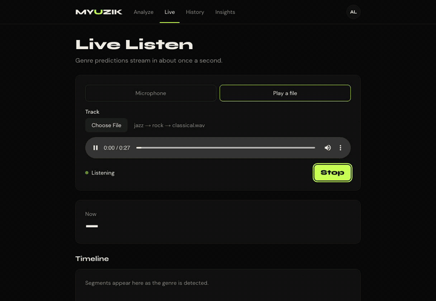
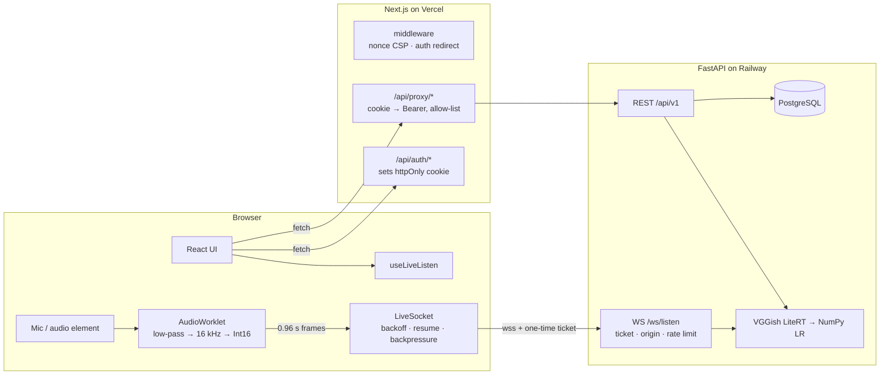

# MYUZIK

**Hear what genre you're listening to.** Upload a track for a full genre breakdown, or turn on **Live Listen** and watch predictions stream in about once a second while music plays.



Next.js 14 · TypeScript (strict) · Tailwind · AudioWorklet · WebSockets · FastAPI · LiteRT · PostgreSQL · Playwright · Vitest

## What's interesting here

- **Real-time audio in the browser.** An AudioWorklet runs on the audio thread. It downmixes the input, applies a windowed-sinc anti-alias filter, resamples to 16 kHz and sends Int16 frames of 0.96 s each, one VGGish window. A `LiveSocket` class streams them over a WebSocket. It reconnects with exponential backoff and jitter, resumes the server-side session, and drops frames when the socket backs up instead of queueing stale audio. Latency is measured per frame by matching the sequence number the server echoes back.
- **A transcript-style UI for a live signal.** The timeline follows the newest segment unless you scroll up, then offers *Jump to live*. Scores pass through an exponential moving average, which damps flicker from individual noisy windows. Genre changes, and nothing else, are announced to screen readers through `aria-live`.
- **Security that holds up when someone pokes at it:**
  - The JWT lives only in an httpOnly, SameSite=Lax cookie set by a Next.js route handler.
  - The proxy only forwards allow-listed routes, so `auth%2Flogin` can't be smuggled through.
  - Login is CSRF-proof: auth routes accept only same-origin JSON.
  - Every page gets a per-request nonce Content-Security-Policy.
  - The WebSocket authenticates with a single-use, 30-second ticket and checks the `Origin` header, so the JWT never appears in a URL.
  - Uploads are checked by magic bytes, MIME type and size on both client and server.
- **A leaner model server.** VGGish is converted to a LiteRT flatbuffer that matches TensorFlow's output, and the classifier is plain NumPy weights. The server ships with no TensorFlow and no pickle files. A live window runs in 14.8 ms, against 33 ms on TensorFlow.
- **Every number below is measured, not claimed.** Each one is produced by a script in this repo and stored in [`docs/metrics/`](docs/metrics).

## Measured

<!-- metrics:start -->
| Metric | Result | Source |
| --- | --- | --- |
| Live latency (frame → prediction) | p50 22 ms · p95 28 ms | [live.json](docs/metrics/live.json) |
| Live upstream bandwidth | 31.4 kB/s (84% below raw 48 kHz float capture) | [live.json](docs/metrics/live.json) |
| Reconnect recovery after a forced drop | 379 ms, 0 frames dropped in 60 s | [live.json](docs/metrics/live.json) |
| Lighthouse mobile (/sign-in, /, /insights, /live) | performance 100 · accessibility 100 | [perf.json](docs/metrics/perf.json) |
| First Load JS, / | 136 kB → 106 kB | [perf.json](docs/metrics/perf.json) |
| Model accuracy (held-out GTZAN, n=197) | 84.8% · macro-F1 0.844 | [model.json](docs/metrics/model.json) |
| VGGish LiteRT vs TensorFlow (2.88 s window) | 14.8 ms vs 33 ms, max embedding diff 6.6e-6 | [model-export.json](docs/metrics/model-export.json) |
| Tests | 93 unit (99.33% lines, 93.83% branches) · 50 Playwright on chromium, firefox, mobile-chrome · 37 pytest · 0 failing axe specs | [tests.json](docs/metrics/tests.json) |
<!-- metrics:end -->

## Architecture



The browser never sees the JWT. REST calls go through the same-origin proxy, which turns the cookie into a `Bearer` header on the server. Vercel route handlers can't proxy WebSockets, so the socket connects straight to FastAPI using a short-lived ticket that the browser fetches through that proxy.

## Run it locally

Requirements: Node 22+, Python 3.11, PostgreSQL, and `vggish.tflite` (from the GitHub release, or rebuilt with `backend/scripts/export_model.py`).

```bash
# backend
cd backend
cp .env.example .env            # set DATABASE_URL and JWT_SECRET (openssl rand -hex 32)
uv venv -p 3.11 && source .venv/bin/activate && uv pip install -r pyproject.toml --extra dev
curl -fLo models/vggish.tflite --create-dirs https://github.com/krogdorlok/Myuzik_Web/releases/download/vggish-v1/vggish.tflite
alembic upgrade head && uvicorn app.main:app --port 8000 --ws-max-size 65536

# frontend
cd frontend
cp .env.local.example .env.local
npm install && npm run dev      # http://localhost:3000
```

## Tests

| Command | What it runs |
| --- | --- |
| `cd backend && pytest` | API, auth, upload validation, history ownership, WebSocket protocol and limits, mocked Spotify, real-model checks |
| `cd frontend && npm run test:ci` | Vitest + React Testing Library for components, hooks and client libraries; fails below 85% line or branch coverage. The Web Audio graph, server-only code and the vitals beacon are excluded from unit coverage and exercised by Playwright instead |
| `cd frontend && npm run test:e2e` | Playwright on Chromium, Firefox, WebKit, Pixel 7 and iPhone 14: auth and security, upload, history, insights, Live Listen with a scripted disconnect, and axe on every page |
| `npm run perf` / `npm run measure:live` | Lighthouse mobile budgets and First Load JS; live latency and recovery numbers. Both write to `docs/metrics/` |

CI ([`.github/workflows/ci.yml`](.github/workflows/ci.yml)) runs pytest, the unit suite, all five Playwright projects and the Lighthouse budgets on every pull request. Two things are opt-in and run locally instead: `npm run measure:live`, which needs a backend and takes a minute, and the real-model pytest checks, which need `models/vggish.tflite` plus `MYUZIK_SAMPLE_CLIP=<any audio file>`.

## Deploy

- **Backend (Railway):** uses `backend/Dockerfile` and `backend/railway.toml`. Set `DATABASE_URL`, `JWT_SECRET`, `FRONTEND_URL` (the exact Vercel origin, which the WebSocket `Origin` check depends on) and optionally the Spotify credentials.
- **Frontend (Vercel):** set the root directory to `frontend`. Set `BACKEND_URL` and `NEXT_PUBLIC_WS_URL` (`wss://<api-host>/ws/listen`).
- **Check:** `scripts/smoke.sh <frontend-url> <backend-url>` verifies liveness and the security posture.

## Model

The classifier is the inference half of [krogdorlok/Myuzik](https://github.com/krogdorlok/Myuzik): frozen VGGish embeddings averaged over 20 s, then multinomial logistic regression trained on GTZAN. The accuracy above is measured on that project's held-out split using this server's own inference code. GTZAN splits aren't artist-filtered, so treat the number as optimistic. VGGish is © Google, Apache-2.0.
